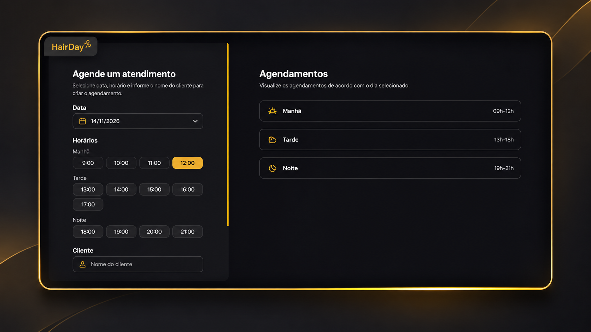

<h1 align="center">✂️ HairDay</h1>

<p align="center">
  Aplicação web para agendamento de cortes de cabelo — simples, rápida e elegante.
</p>

<p align="center">
  
</p>

<p align="center">
  
  
  
  
  
</p>

---

## 📋 Índice

- [Sobre o projeto](#-sobre-o-projeto)
- [Funcionalidades](#-funcionalidades)
- [Tecnologias](#-tecnologias)
- [Como executar](#-como-executar)
- [Estrutura de pastas](#-estrutura-de-pastas)
- [Como funciona (fluxo da aplicação)](#-como-funciona-fluxo-da-aplicação)
- [Funções do projeto](#-funções-do-projeto)
- [API](#-api)
- [Como foi criado](#-como-foi-criado)

---

## 💈 Sobre o projeto

O **HairDay** é uma aplicação web para **gerenciar a agenda de um salão / barbearia**. Com ela, é possível:

- escolher uma data no calendário;
- selecionar um horário livre;
- informar o nome do cliente e criar o agendamento;
- visualizar todos os agendamentos do dia, separados por **Manhã**, **Tarde** e **Noite**;
- cancelar um agendamento com um clique.

Tudo isso feito com **JavaScript puro (Vanilla JS)**, organizado em módulos, empacotado com **Webpack** e consumindo uma API fake criada com **JSON Server**.

---

## ✨ Funcionalidades

| Funcionalidade | Descrição |
| --- | --- |
| 📅 **Seleção de data** | O input de data já abre no dia atual e não permite escolher datas passadas. |
| 🕘 **Horários do dia** | Lista os horários de 9:00 às 21:00, agrupados em Manhã, Tarde e Noite. |
| 🚫 **Bloqueio de horários** | Horários já agendados ou que já passaram ficam indisponíveis. |
| ✅ **Novo agendamento** | Valida nome e horário e salva o agendamento na API. |
| 📋 **Lista de agendamentos** | Mostra os agendamentos do dia selecionado em cada período. |
| ❌ **Cancelamento** | Remove o agendamento da API após confirmação do usuário. |
| 🔄 **Atualização automática** | Ao criar, cancelar ou trocar de data, a tela é recarregada com os dados atualizados. |

---

## 🛠 Tecnologias

- **HTML5** e **CSS3** — estrutura e estilização (tema escuro com detalhes em dourado)
- **JavaScript (ES Modules)** — toda a lógica da aplicação
- **[Day.js](https://day.js.org/)** — manipulação e formatação de datas (com locale `pt-br`)
- **[Webpack 5](https://webpack.js.org/)** — empacotamento dos módulos e servidor de desenvolvimento
- **[Babel](https://babeljs.io/)** — transpila o JavaScript moderno para maior compatibilidade
- **[JSON Server](https://github.com/typicode/json-server)** — API REST fake a partir do arquivo `server.json`
- **Plugins do Webpack:** `html-webpack-plugin`, `copy-webpack-plugin`, `css-loader`, `style-loader`, `babel-loader`

---

## 🚀 Como executar

### Pré-requisitos

- [Node.js](https://nodejs.org/) instalado (versão 18 ou superior recomendada)

### Passo a passo

```bash
# 1. Clone o repositório
git clone https://github.com/EloaGuilgel/hairday.git
cd hairday

# 2. Instale as dependências
npm install

# 3. Em um terminal, suba a API fake (porta 3333)
npm run server

# 4. Em outro terminal, rode a aplicação (porta 3000)
npm run dev
```

O navegador abrirá automaticamente em `http://localhost:3000`.

### Scripts disponíveis

| Script | O que faz |
| --- | --- |
| `npm run dev` | Inicia o `webpack-dev-server` na porta **3000** com live reload. |
| `npm run server` | Inicia o `json-server` observando o `server.json` na porta **3333**. |
| `npm run build` | Gera a versão final da aplicação na pasta `dist/`. |

---

## 📁 Estrutura de pastas

```
hairday/
├── docs/
│   └── cover.png                     # Imagem de capa do README
├── src/
│   ├── assets/                       # Ícones SVG (logo, períodos, calendário, cancelar...)
│   ├── libs/
│   │   └── dayjs.js                  # Configura o Day.js com locale pt-br
│   ├── modules/
│   │   ├── form/
│   │   │   ├── date-change.js        # Recarrega os dados quando a data muda
│   │   │   ├── hours-click.js        # Seleção visual do horário clicado
│   │   │   ├── hours-load.js         # Renderiza os horários disponíveis/indisponíveis
│   │   │   └── submit.js             # Envio do formulário (novo agendamento)
│   │   ├── schedules/
│   │   │   ├── cancel.js             # Cancelamento de agendamentos
│   │   │   ├── load.js               # Orquestra a busca e renderização do dia
│   │   │   └── show.js               # Exibe os agendamentos por período
│   │   └── page-load.js              # Carrega os dados ao abrir a página
│   ├── services/
│   │   ├── api-config.js             # URL base da API
│   │   ├── schedule-cancel.js        # DELETE /schedules/:id
│   │   ├── schedule-fetch-by-day.js  # GET /schedules (filtrado por dia)
│   │   └── schedule-new.js           # POST /schedules
│   ├── styles/
│   │   ├── global.css                # Variáveis, reset e estilos gerais
│   │   ├── form.css                  # Estilos do formulário de agendamento
│   │   ├── schedule.css              # Estilos da lista de agendamentos
│   │   └── index.css
│   ├── utils/
│   │   └── opening-hours.js          # Horários de funcionamento
│   └── main.js                       # Ponto de entrada da aplicação
├── index.html                        # Template HTML
├── server.json                       # "Banco de dados" do JSON Server
├── webpack.config.js                 # Configuração do Webpack
└── package.json
```

A organização segue uma separação clara de responsabilidades:

- **`services/`** → só conversa com a API (requisições HTTP).
- **`modules/`** → lógica de interface (DOM, eventos, renderização).
- **`utils/`** e **`libs/`** → dados fixos e configurações reutilizáveis.

---

## 🔄 Como funciona (fluxo da aplicação)

```
             ┌──────────────────────┐
             │   DOMContentLoaded   │  (page-load.js)
             │   change da data     │  (date-change.js)
             │   submit / cancelar  │  (submit.js / cancel.js)
             └──────────┬───────────┘
                        ▼
              ┌───────────────────┐
              │  schedulesDay()   │  (load.js)
              └─────────┬─────────┘
                        ▼
          ┌────────────────────────────┐
          │ scheduleFetchByday({date}) │ ──► GET /schedules
          └─────────────┬──────────────┘
                        ▼
        ┌───────────────┴────────────────┐
        ▼                                ▼
┌──────────────────┐          ┌──────────────────────┐
│ schedulesShow()  │          │     hoursLoad()      │
│ lista Manhã /    │          │ horários livres e    │
│ Tarde / Noite    │          │ ocupados + hoursClick│
└──────────────────┘          └──────────────────────┘
```

A função **`schedulesDay()`** é o coração da aplicação: sempre que algo muda (abrir a página, trocar a data, criar ou cancelar um agendamento), ela busca os dados do dia e redesenha a tela.

---

## 🧩 Funções do projeto

### 📂 `modules/schedules`

#### `schedulesDay()` — [load.js](src/modules/schedules/load.js)
Função assíncrona que:
1. lê a data selecionada no input;
2. busca os agendamentos daquele dia com `scheduleFetchByday`;
3. exibe os agendamentos com `schedulesShow`;
4. renderiza os horários com `hoursLoad`.

#### `schedulesShow({ dailySchedules })` — [show.js](src/modules/schedules/show.js)
Limpa as listas de Manhã, Tarde e Noite e cria um `<li>` para cada agendamento contendo:
- o horário (`HH:mm`) em um `<strong>`;
- o nome do cliente em um `<span>`;
- o ícone de cancelar (`cancel-icon`);
- o atributo `data-id` com o id do agendamento.

Distribui cada item no período correto:
- **Manhã** → até 12h
- **Tarde** → de 13h às 18h
- **Noite** → depois das 18h

#### Cancelamento — [cancel.js](src/modules/schedules/cancel.js)
Adiciona um ouvinte de clique em cada lista de período (técnica de **delegação de eventos**). Quando o clique é no ícone `.cancel-icon`:
1. encontra o `<li>` mais próximo com `closest("li")`;
2. lê o `id` via `dataset`;
3. pede confirmação com `confirm()`;
4. chama `scheduleCancel({ id })` e depois `schedulesDay()` para atualizar a tela.

---

### 📂 `modules/form`

#### `hoursLoad({ date, dailySchedules })` — [hours-load.js](src/modules/form/hours-load.js)
Monta a lista de horários do formulário:
1. limpa a lista atual;
2. calcula os horários ocupados a partir dos agendamentos do dia;
3. para cada horário de `openingHours`, verifica se ele **já passou** (`isBefore(dayjs())`) ou **já está ocupado**;
4. cria os `<li>` com a classe `hour-available` ou `hour-unavailable`;
5. insere os títulos **Manhã**, **Tarde** e **Noite** nos pontos certos;
6. chama `hoursClick()` para ativar a seleção.

#### `hourHeaderAdd(title)` — [hours-load.js](src/modules/form/hours-load.js)
Função auxiliar que cria um `<li class="hour-period">` com o título do período.

#### `hoursClick()` — [hours-click.js](src/modules/form/hours-click.js)
Adiciona evento de clique em todos os horários disponíveis. Ao clicar, remove a classe `hour-selected` de todos e a adiciona apenas ao horário escolhido (destacado em dourado).

#### Envio do formulário — [submit.js](src/modules/form/submit.js)
- Define o valor e o **mínimo** do input de data como o dia de hoje (não dá pra agendar no passado).
- No `onsubmit`:
  1. evita o recarregamento da página (`preventDefault`);
  2. valida se o nome foi preenchido;
  3. valida se um horário foi selecionado;
  4. monta a data completa (`when`) somando a hora à data escolhida;
  5. gera um `id` com `new Date().getTime()`;
  6. salva com `scheduleNew()`, recarrega com `schedulesDay()` e limpa o campo de nome.

#### Troca de data — [date-change.js](src/modules/form/date-change.js)
Quando o input de data muda, chama `schedulesDay()` para recarregar horários e agendamentos.

---

### 📂 `modules`

#### Carregamento da página — [page-load.js](src/modules/page-load.js)
No evento `DOMContentLoaded`, chama `schedulesDay()` para mostrar os dados do dia atual assim que a página abre.

---

### 📂 `services`

| Função | Arquivo | Método | Descrição |
| --- | --- | --- | --- |
| `apiConfig` | [api-config.js](src/services/api-config.js) | — | Objeto com a `baseURL` da API (`http://localhost:3333`). |
| `scheduleFetchByday({ date })` | [schedule-fetch-by-day.js](src/services/schedule-fetch-by-day.js) | `GET` | Busca todos os agendamentos e filtra apenas os do dia com `dayjs(date).isSame(when, "day")`. |
| `scheduleNew({ id, name, when })` | [schedule-new.js](src/services/schedule-new.js) | `POST` | Cria um novo agendamento e exibe mensagem de sucesso. |
| `scheduleCancel({ id })` | [schedule-cancel.js](src/services/schedule-cancel.js) | `DELETE` | Remove o agendamento pelo id e exibe mensagem de sucesso. |

Todas as funções de serviço usam `try/catch` e mostram um `alert` amigável em caso de erro.

---

### 📂 `utils` e `libs`

- **`openingHours`** — [opening-hours.js](src/utils/opening-hours.js): array com os horários de funcionamento, de `"9:00"` a `"21:00"`.
- **Configuração do Day.js** — [dayjs.js](src/libs/dayjs.js): importa o Day.js e define o idioma `pt-br`.

---

## 🌐 API

A API fake é servida pelo **JSON Server** a partir do arquivo [`server.json`](server.json).

**Base URL:** `http://localhost:3333`

| Método | Rota | Descrição |
| --- | --- | --- |
| `GET` | `/schedules` | Lista todos os agendamentos |
| `POST` | `/schedules` | Cria um agendamento |
| `DELETE` | `/schedules/:id` | Remove um agendamento |

**Exemplo de agendamento:**

```json
{
  "id": "1794662693545",
  "name": "Fabio de Oliveira",
  "when": "2026-11-19T14:00:00.000Z"
}
```

---

## 🏗 Como foi criado

O projeto foi construído passo a passo, em pequenos commits, seguindo esta evolução:

1. **Estrutura e layout** — HTML semântico e CSS com tema escuro e destaques em dourado.
2. **Configuração do ambiente** — Webpack, Babel, loaders de CSS e plugins para HTML e assets.
3. **Formulário** — data mínima no dia atual, horários de funcionamento e seleção de horário.
4. **API fake** — configuração do JSON Server e do serviço de criação de agendamentos.
5. **Busca por dia** — serviço que filtra os agendamentos pela data selecionada.
6. **Renderização** — exibição dos agendamentos separados por Manhã, Tarde e Noite.
7. **Bloqueio de horários** — horários ocupados ou passados ficam indisponíveis.
8. **Cancelamento** — remoção de agendamentos pela API com confirmação.

### Conceitos praticados

- Modularização com **ES Modules** (`import` / `export`)
- Manipulação do **DOM** (`createElement`, `classList`, `dataset`, `closest`)
- **Delegação de eventos**
- **Async/Await** e **Fetch API**
- Tratamento de erros com **try/catch**
- Manipulação de datas com **Day.js**
- Empacotamento com **Webpack** e transpilação com **Babel**
- Consumo de uma API REST (**GET**, **POST**, **DELETE**)

---

<p align="center">
  Feito com 💛 e muito ☕ — <strong>HairDay</strong> ✂️
</p>
